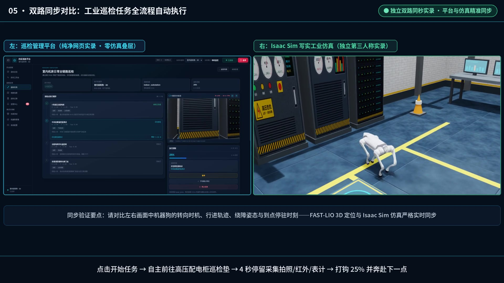
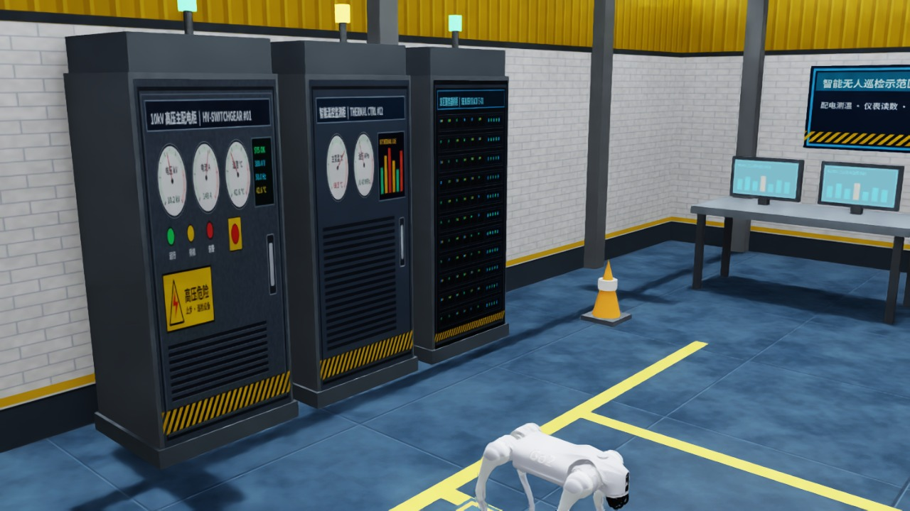
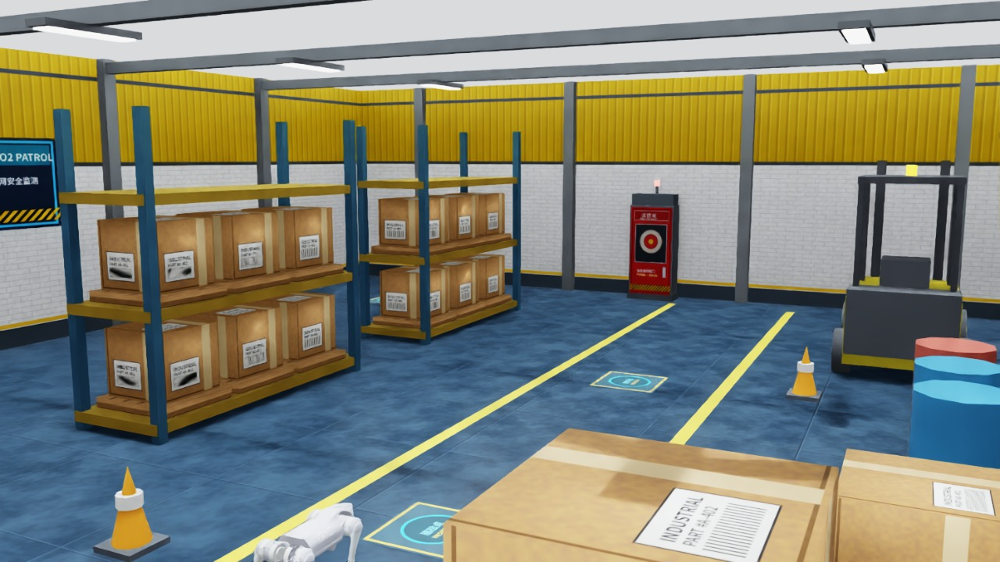

# QuadPatrol · 四足智巡平台

面向工业巡检场景的四足机器狗智能管控平台（Vue 3 + Three.js + Express + ROS 2 Humble + FAST-LIO + Nav2 + Isaac Sim），集成 3D/2D 实时地图、定点与多点自主导航、巡检任务编排与执行、巡检报告与告警溯源、多机器狗接入及三大高写实 GPU 工业仿真环境。

## 🎬 平台功能实拍演示

[](docs/media/platform_intro.mp4)

<video src="docs/media/platform_intro.mp4" controls width="100%" poster="docs/media/demo_mission_sync.jpg"></video>

- **完整平台介绍视频（含中文解说、字幕与平台/仿真双路同秒同步对比）**：[`docs/media/platform_intro.mp4`](docs/media/platform_intro.mp4)（1080p · 30 fps · 2 分 51 秒）
  - 完整演示：巡检总览 → 写实配电室 3D 单点定点导航 → 3 航点多点连续自主巡航（`3 → 2 → 1 → 0`）→ 2D 栅格实时导航 → 工业巡检任务全流程自动执行（到点停留采集 → 自动打钩推进）→ 巡检报告超温溯源与三大工业场景展示。
- **独立 Isaac Sim 写实仿真全程实录（纯仿真第三人称视角，无网页叠层）**：[`docs/media/isaac_sim_recording.mp4`](docs/media/isaac_sim_recording.mp4)（720p · 30 fps · 1 分 43 秒）

### 三大高写实工业巡检仿真场景

| 室内配电与机房巡检 (`indoor`) | 工业仓储物流巡检 (`warehouse`) | 户外变电站巡检 (`outdoor`) |
| :---: | :---: | :---: |
|  |  |  |
| 10kV 高压配电柜表盘、温控柜、42U 服务器机柜、红蓝黄消防管网阀门与压力表 | 蓝橙重型工业货架、栈板纸箱、黄色叉车、危化品桶与消防栓站 | 沥青巡检道路、户外高压主变台区与陶瓷套管、防滑检修坡道与护栏 |

## 启动

### 使用 ROS 开发容器

Docker 只提供 ROS 2、Node.js 和 RViz 开发工具，不包含本项目，也不会自动启动项目。源码挂载在容器的 `/root/ros2_ws`。

```bash
docker exec -it ros2-humble-dev bash
```

进入容器后手动启动：

```bash
cd /root/ros2_ws/QuadPatrol
npm ci
bash scripts/start_console.sh
```

打开 http://localhost:5173 。修改 Vue 文件后页面会自动刷新。

### 本机 Ubuntu / WSL

需要 Node.js 18+、ROS 2 Humble 和 foxglove_bridge。

```bash
npm ci
bash scripts/start_console.sh
```

脚本会启动前端、后端和 Foxglove。

## 配置

优先在网页“系统配置”中修改，保存后立即写入配置文件，不需要修改前端或后端代码。可配置 ROS 工作空间、地图目录、全部 ROS 话题（包括相机和 3D 点云）、全局线/角速度、指令频率、断链停车时间、仿真是否自动建图以及建图和导航任务。话题修改后请重新连接机器人，任务修改后请重启对应任务；`mapping.auto_start` 默认是 `false`，在下次启动仿真场景时生效。

“机器狗管理”可为每台设备选择 2D/3D 雷达、建图算法和定位方式。2D 支持 SLAM Toolbox、Cartographer 和 AMCL；3D 支持 FAST-LIO 与 FAST-LIO Localization，也可填写自定义 ROS 包和 Launch 文件名。首页只展示这些实际配置，不代表算法已在线运行。

FAST-LIO 接入默认点云为 `/points`、IMU 为 `/imu`；常见输出为 `/Odometry`、`/cloud_registered`、`/path` 和 `camera_init → body` TF。平台会在选择 FAST-LIO 且未另改里程计时使用 `/Odometry`，并兼容其 TF 坐标链。所有话题仍可在系统配置中修改。算法本体及所需 ROS 包由机器人侧部署，平台负责配置、启动任务管理和结果接入。

也可以手工修改 `config/ros_config.json`：

```json
{
  "workspace": "..",
  "maps_dir": "maps"
}
```

- `workspace`：ROS 工作空间目录，后端会加载其中的 `install/setup.bash`。默认是项目上一级目录，也可以改成你的 ROS 工作空间绝对路径。
- `maps_dir`：地图保存和读取目录。相对路径按项目目录计算。
- `tasks`：Foxglove、建图和导航命令。
- `topics`：机器人话题名称。

前端地址默认无需设置。如果后端或 Foxglove 不在本机，修改 `src/config.js` 即可。

### 后端绑定与 API 认证

后端默认只监听 `127.0.0.1`。需要监听非 loopback 地址时必须同时设置 `HOST` 和非空 `API_TOKEN`，否则后端拒绝启动，例如：

```bash
HOST=0.0.0.0 API_TOKEN='replace-with-a-secret' bash scripts/start_console.sh
```

开发服务器的 `/api` 代理会在 Node.js 进程内把 `API_TOKEN` 注入 `Authorization: Bearer` 请求头；该变量不会进入前端 bundle，也不要把它配置成 `VITE_API_TOKEN`。生产环境若浏览器需要直接访问非同源、启用令牌的 API，前端 `apiFetch` 需要通过 `VITE_API_TOKEN` 提供令牌；这种构建变量及其令牌对浏览器用户可见，应仅使用权限受限的专用令牌。默认 loopback 模式不需要令牌。

`POST /api/navigation/speed_limits` 接收 `{scene,maxLinearSpeed,maxAngularSpeed}`，设置 RPP 的 `FollowPath.desired_linear_vel`、`FollowPath.rotate_to_heading_angular_vel`，并设置对应 `velocity_smoother` 的 `max_velocity=[linear,0.0,angular]`、`min_velocity=[-linear,0.0,-angular]` 作为最终线/角速度硬上限；失败会回滚并重读校验全部 RPP 与 smoother 参数。`POST /api/cancel_navigation` 接收 `{scene,namespace?}`，等待对应 `navigate_to_pose` 的 `CancelGoal` 服务返回真实结果。

机器人、任务、记录和告警集合 GET 返回 `{hasData,items,version}`；PUT 接收 `{items,version}` 并以 `{items,version}` 原子持久化。旧版纯数组文件按 version 0 读取，首次保存自动迁移；缺 version 的旧客户端仍可写入，并发覆盖冲突返回 409 和最新数据。

## 页面与多机器人

左侧导航包含七个页面：

- **巡检总览**：机器狗状态、任务进展、完成率和最新告警。
- **巡检工作台**：机器狗机载实时画面、SLAM、导航点、建图和运动控制集中在同一页面。
- **单机监控**：实时地图、运动控制、遥测和图层。
- **巡检任务**：任务列表、巡检点与动作编辑、执行进度和控制。
- **地图场景**：建图、导航、多场景切换和栅格地图编辑。
- **巡检记录**：任务筛选、巡检点结果、传感器读数和时间线。
- **告警中心**：告警筛选、确认、处理和关联任务回溯。
- **机器狗管理**：新增、编辑、删除和切换机器狗配置，支持实体机器狗与本机仿真一键接入。
- **系统配置**：在线修改 ROS 工作空间、地图目录、全部话题、相机以及建图和导航任务参数。

“巡检工作台”的“机器人连接”只需从下拉框选择配置好的机器人，选择后会自动连接或切换，不需要重复输入 IP，也没有手动连接/断开按钮。

机器人配置同时保存在后端 `data/robots.json` 和当前浏览器的 `localStorage`。每台机器人支持独立局域网 IP / 主机名、端口、通信协议和可选话题命名空间，例如命名空间为 `robot2` 时，`/scan` 会转换为 `/robot2/scan`。平台预置室内、仓库、户外三条 3D 仿真狗，均使用 FAST-LIO。

通信支持 Foxglove（默认端口 `8765`）、ROS 原生 `rosbridge_server`（默认端口 `9090`）和自研 DogLink。三条仿真狗使用 DogLink，统一网关进程分别监听 `8770`、`8771`、`8772`，各连接只订阅对应场景命名空间的话题。

DogLink 同时作为标准 `ament_python` ROS 2 功能包维护，源码位于 `ros_packages/doglink`。协议与序列化、WebSocket 传输、ROS 订阅适配分别位于 `protocol.py`、`serializers.py`、`websocket.py` 和 `ros_adapter.py`，线上协议版本保持为 1。未构建功能包时，现有启动脚本会直接从源码运行；构建后也可以使用标准 ROS 命令：

```bash
mkdir -p ~/doglink_ws/src
ln -s "$PWD/ros_packages/doglink" ~/doglink_ws/src/doglink
cd ~/doglink_ws
colcon build --packages-select doglink
source install/setup.bash
ros2 run doglink gateway_node
# 或使用 YAML 配置和 Launch
ros2 launch doglink doglink.launch.py
```

默认监听 `127.0.0.1:8768`；远程部署需显式设置监听地址并在外层配置 TLS 和访问认证。可通过 `config/doglink.yaml` 或 `--ros-args -p host:=... -p port:=...` 修改参数。

当前为一个活动连接：切换机器人会断开上一台并清空其地图与遥测，再连接新机器人，避免不同机器人的数据混在同一地图中。

## 地图管理

在右侧“任务控制”中打开“地图”标签，可以：

- 查看地图名称、修改时间和文件大小。
- 在多个场景之间切换，并将选中的场景用于导航。
- 使用障碍、空闲、未知三种笔刷直接编辑 SLAM 栅格地图。
- 调整笔刷大小、缩放和平移视图，支持撤销和重做。
- 覆盖保存或另存为新场景；覆盖保存前会在地图目录的 `.backups/` 中备份原图。
- 重命名地图，同时更新 YAML 与 PGM 文件名及 YAML 内的图像路径。
- 删除不再需要的地图文件。
- 修改后自动刷新导航页面的地图下拉框。

删除正在用于导航的地图前，请先停止对应导航任务。编辑或切换场景后，请重启导航任务以加载最新地图。

## 开发

```text
src/App.vue                       页面布局
src/assets/main.css               全局样式
src/components/                   页面组件（含 3D/2D 地图与控制面板）
src/composables/                  ROS 2 通信（DogLink / Foxglove / rosbridge）
src/features/                     巡检业务页面（任务、记录、告警等）
src/layout/                       应用外壳与导航
src/router.js                     页面路由
server/index.js                   后端服务与 ROS 任务管理
gateway/doglink_gateway.py        DogLink 轻量级 ROS 2 WebSocket 网关
config/ros_config.json            ROS 话题与仿真任务配置
config/nav2_params.yaml           Nav2 3D VoxelLayer 导航参数
simulation/run_scene.py           Isaac Sim 仿真主入口
simulation/scene_assets.py        高写实工业巡检场景 PBR 资产生成器
simulation/ros2_bridge.py         仿真与 ROS 2 双向传感器/控制桥接
simulation/nav2_launch.py         FAST-LIO 3D 定位 + Nav2 统一启动脚本
simulation/fastlio_localization.py FAST-LIO 3D 全局定位与 ICP 配准节点
simulation/nav2_bridge_helper.py  人工接管自动取消导航辅助节点
maps/indoor_substation.*          室内配电房 3D 点云与 2D 占据栅格地图
docs/media/                       平台介绍视频、独立仿真录像与场景展示图
scripts/start_console.sh          控制台一键启动脚本
```

检查代码：

```bash
npm run build
node --check server/index.js
```

## 建图和导航

本项目不包含具体机器人的建图或导航实现，默认 `mapping` 和 `navigation` 任务为空。根据自己的机器人修改 `config/ros_config.json`，例如：

```json
{
  "command": "ros2",
  "args": ["launch", "your_slam_package", "slam.launch.py"]
}
```

保存地图默认使用 `nav2_map_server/map_saver_cli`，也可以修改 `save_map`。

仿真场景与实机均支持 **FAST-LIO 3D 定位（3D 点云 + IMU + ICP 全局配准）+ 开源 Nav2（3D `VoxelLayer` 体素避障 + Navfn A* 全局规划 + Regulated Pure Pursuit 控制与恢复）** 巡检导航。使用前需安装 ROS 2 Humble Nav2 功能包：

```bash
sudo apt update && sudo apt install -y ros-humble-navigation2 ros-humble-nav2-bringup
```

在工作台“定位”或“导航”页选择已保存的地图（`.yaml` + `.pgm` + `.pcd`）并启动，Nav2 参数位于 `config/nav2_params.yaml`，启动脚本位于 `simulation/nav2_launch.py`；定位节点 `simulation/fastlio_localization.py` 负责将 FAST-LIO 3D 里程计与保存 `.pcd` 地图对齐并输出 `map → odom` TF 与 `/localization`；伴随节点 `simulation/nav2_bridge_helper.py` 负责在人工 WASD/摇杆接管时取消 Nav2 当前目标。启动后单击地图目标或添加多点航点即可巡检。建图与定位导航使用独立任务状态，停止场景会同时停止相关任务。

测试不同机器人或仿真器时，可通过 `ROS_CONFIG_FILE` 指向项目外的配置文件，不需要修改仓库默认配置：

```bash
ROS_CONFIG_FILE=/path/to/test_config.json bash scripts/start_console.sh
```

网页和 Foxglove 可以独立运行；实际建图、保存地图和导航需要你的 ROS 环境提供对应功能包。

## GPU 仿真测试

项目提供三个高写实 Isaac Sim 工业巡检场景（纯本地离线 PBR 纹理与多部件工业设备建模，无需等待云端下载），均使用 Unitree Go2 关节模型、真实碰撞和 CUDA 物理计算：

- `indoor`：室内配电与机房巡检（12 × 10 m），包含环氧地坪与安全通道、10kV 高压主配电柜表盘、智能温控监测柜、42U 服务器机柜阵列、SCADA 双屏监控台、红蓝黄消防管网与阀门压力表站及消防栓箱。
- `warehouse`：工业仓储物流巡检（16 × 13 m），包含蓝橙重型工业钢货架、木质栈板与条码纸箱、黄色工业叉车、危化品桶、仓库配电柜与消防栓站。
- `outdoor`：户外变电站巡检（17 × 14 m），包含沥青道路标线、户外高压主变台区（散热片 + 陶瓷高压套管）、户外开关柜、带安全护栏的混凝土检修坡道与工业台阶及警示防撞墩。

在“仿真测试”中可以分别启动三条狗，三个场景可同时运行。平台默认使用无界面物理实例，并降低单机器人场景的 PhysX 预分配，以便在 16 GiB 显存上同时运行；相机、3D 点云和 IMU 保持启用。FAST-LIO 默认仅在手动开始建图后启动，也可在“系统配置 → 建图控制”中开启场景启动时自动建图。也可以从终端启动带图形窗口的单场景：

```bash
bash scripts/start_simulation.sh indoor
bash scripts/start_simulation.sh warehouse
bash scripts/start_simulation.sh outdoor
```

Go2 默认保持站立，蓝色圆环为建议巡检点。启动后，网页会显示运动摇杆和位置、朝向、速度遥测；拖动摇杆可以控制前进、后退和转向，松手或点击“停止运动”即停车，控制指令超过 0.6 秒未更新也会自动停车。

默认使用 `cuda:0`，可通过 `SIM_DEVICE` 修改设备，通过 `ISAACLAB_PYTHON` 指定 Isaac Lab Python 解释器。室内、仓库、户外控制端口分别为 `8766`、`8767`、`8769`，DogLink 端口分别为 `8770`、`8771`、`8772`，话题命名空间分别为 `/indoor`、`/warehouse`、`/outdoor`。可用 `SIMULATION_CONTROL_URL_INDOOR`、`SIMULATION_CONTROL_URL_WAREHOUSE`、`SIMULATION_CONTROL_URL_OUTDOOR` 修改后端连接地址。

仿真使用本机 `ROS_DOMAIN_ID=88` 和 `ROS_LOCALHOST_ONLY=1`，正常模式按物理步长实时运行。仿真任务会清除实机使用的 `FASTRTPS_DEFAULT_PROFILES_FILE`，避免固定 peers 配置隔离本机节点；通用建图、导航和实机 Foxglove 任务仍保留该环境变量。

每个场景会同时启动 ROS 2 双向桥接，提供以下话题：

- 订阅 `/cmd_vel`（`geometry_msgs/Twist`），网页可通过 Foxglove 使用同一话题控制仿真。
- 发布 `/odom`、`/imu`、`/scan` 和 `/battery`。
- 发布 `/points`（`PointCloud2`）：16 通道、360°、2° 水平分辨率、20 m 量程、10 Hz，包含 `ring` 和逐点 `time` 字段，供 FAST-LIO 运动补偿与 3D 接入链路验证。
- 发布 `/camera1/preview/compressed`，为 Go2 机载第一视角（640×360、30 Hz、JPEG）。
- 发布 `map → odom → base_link → base_scan` 的 `/tf`，巡检工作台可以显示机器狗位置与 3D 点云。3D 雷达机器狗不订阅或显示 2D 激光；2D 激光图层与健康检查仅在选择 2D 雷达时出现。

可在终端验证：

```bash
ros2 topic list
ros2 topic echo /odom --once
ros2 topic pub --once /cmd_vel geometry_msgs/msg/Twist '{linear: {x: 0.3}, angular: {z: 0.0}}'
ros2 topic pub --once /cmd_vel geometry_msgs/msg/Twist '{linear: {x: 0.0}, angular: {z: 0.0}}'
```

无界面物理自检（以室内场景为例）：

```bash
bash scripts/start_simulation.sh indoor --headless --test-steps 120
```

仿真运动使用 RSL-RL 训练的 Go2 关节运动策略，WASD 和摇杆提供速度目标，策略以 50 Hz 推理并通过 12 个关节驱动机器狗，物理循环为 200 Hz，不直接写入基座运动速度或自动扶正。线/角速度目标限制为 ±1 m/s、±1 rad/s，与策略训练范围一致。模型来自 [Isaac-Velocity-Flat-Unitree-Go2-v0-No-Env-Noise](https://huggingface.co/OneSleepyGuy/Isaac-Velocity-Flat-Unitree-Go2-v0-No-Env-Noise)，本地文件为 `simulation/policies/go2_velocity_flat.pt`。建图和导航仍需安装并配置 SLAM、Nav2 功能包，不能直接替代真实步态与整机联调。
