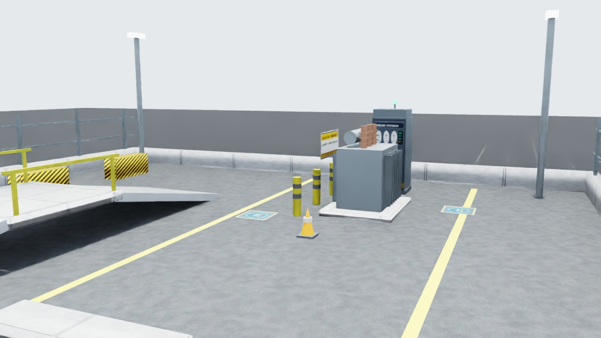

# QuadPatrol · 四足智巡平台

面向配电房、变电站、工业仓储等场景的四足机器狗智能巡检平台。

QuadPatrol 将实时监控、自主导航、任务执行、异常告警和巡检报告连接成完整闭环，让机器狗真正参与日常巡检，而不只是展示一张地图。

## 视频预览

| 平台功能演示 | Isaac Sim 仿真实录 |
| :---: | :---: |
| [](docs/media/platform_intro.mp4) | [](docs/media/isaac_sim_recording.mp4) |
| 平台与仿真同步对比，展示导航、连续巡航、任务执行和报告溯源 · 2 分 51 秒 | 独立第三人称视角，展示机器狗运动与工业场景 · 1 分 43 秒 |

点击封面即可观看视频。

## 平台能做什么

- **实时掌握现场**：机载画面、2D 栅格地图、3D 点云、机器人位姿与运动状态集中呈现。
- **自主完成导航**：支持单点目标、多点连续巡航、地图选点、暂停与终止任务，以及人工接管和急停。
- **闭环执行巡检**：编排巡检点和采集动作，自动执行、记录过程并生成可回溯的巡检报告。
- **及时发现异常**：集中管理告警，关联任务、巡检点和现场数据，方便定位问题。
- **统一管理设备**：接入多台实体机器狗或仿真机器狗，按设备切换地图、话题和运行模式。
- **先在仿真中验证**：在贴近真实工业环境的 GPU 场景中验证导航、控制和任务流程，降低实机调试成本。

## 三大工业仿真场景

| 室内配电与机房 | 工业仓储物流 | 户外变电站 |
| :---: | :---: | :---: |
|  |  |  |
| 配电柜、服务器机柜、监控台与消防设施 | 重型货架、栈板货物、叉车与窄通道 | 主变台区、检修坡道、护栏与户外道路 |

三个场景均支持机器狗运动、传感器数据、定位与自主导航，可独立运行，也可用于多机并行测试。

## 一条完整的巡检流程

1. 选择机器狗和作业地图。
2. 配置巡检点、执行顺序和采集动作。
3. 启动任务，实时查看画面、轨迹与执行进度。
4. 到点自动采集并记录结果，异常时及时告警。
5. 在巡检报告中回看过程、定位问题并追溯现场。

## 快速体验

需要 Node.js 18+ 和 ROS 2 Humble 环境：

```bash
npm ci
bash scripts/start_console.sh
```

打开 [http://localhost:5173](http://localhost:5173)。

也可以单独启动室内仿真：

```bash
bash scripts/start_simulation.sh indoor
```

## 技术基础

Vue 3 · Three.js · Express · ROS 2 Humble · FAST-LIO · Nav2 · Isaac Sim
